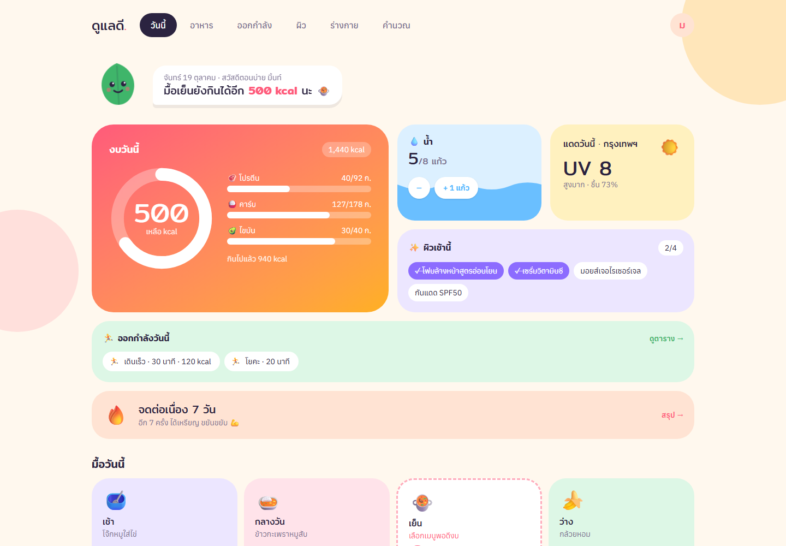
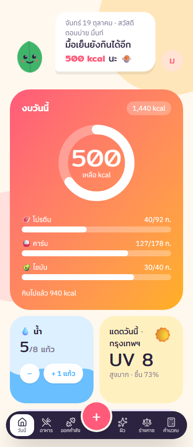
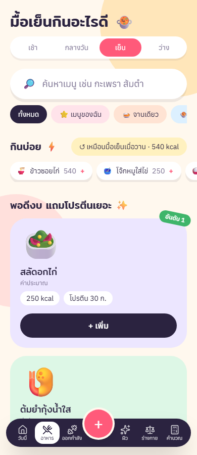
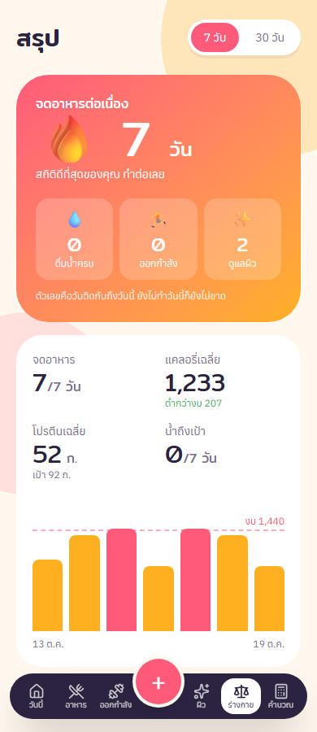
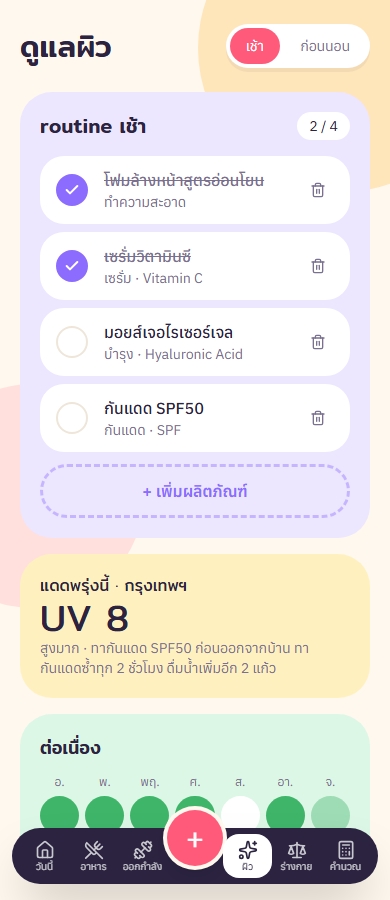
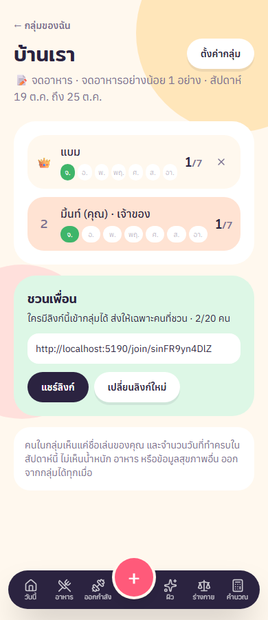

# ดูแลดี · dulaedee-web

Web frontend for **dulaedee** (ดูแลดี, "take good care"), a health app for friends and family. It counts calories for Thai dishes and logs water, weight, skin routines and workouts. Streaks, badges and weekly group challenges keep people coming back. The interface is in Thai.

Vue 3 · Vite · TypeScript · Pinia · Element Plus · Tailwind v4. Talks to the [`dulaedee-service`](https://github.com/Teruakii/dulaedee-service) API.

## Features

- **Today:** remaining calorie budget, macros, water, UV index, skin routine, today's workout and the logging streak
- **Food:** search Thai dishes, add frequent foods or "same as yesterday" in one tap, and get dishes that fit the remaining budget. Unverified values are marked as estimates
- **Summary:** 7 or 30 day averages, a daily calorie chart, a weight trend with a 4-week projection, streaks for 4 habits, and 7 badges
- **Group challenges:** invite friends with a link and compete each week (Monday to Sunday). Members see only each other's first names and day counts
- **Skin:** morning and night routines, with warnings for ingredients that should not be used together
- **Body:** weight chart, BMI on the Asian scale, and 7 days of water
- Also: workout plan, calorie calculator, Web Push reminders, Google login, email verification, terms and privacy pages, and admin pages for the menu and clips

## Screenshots



| Today | Food | Summary |
|---|---|---|
|  |  |  |

| Skin | Body | Group challenge |
|---|---|---|
|  |  |  |

Taken from the running app with 7 days of sample data.

## Getting started

```bash
npm install
cp .env.example .env     # baseURL points to the API on port 3200
npm run dev              # http://localhost:5190
```

To try it without MongoDB, run `npm run dev:demo` in `dulaedee-service`. Then log in with `mind@example.com` / `password1` (admin: `admin` / `admin-demo-pass`).

## Checks

```bash
npm run type-check
npm run build-only
```

## Structure

- `src/api/health/*.api.ts`: one function per endpoint, each returning `data`
- `src/stores/day.pinia.ts`: the selected day's log, shared by every page. `profile.pinia.ts` holds body data and the budget
- `src/utils/labels.ts`: Thai labels for every enum from the backend
- `src/assets/css/main.css`: color and font tokens. Views use token names, not hex values
- `src/views/legal/`: terms of use and privacy policy. These are drafts: fill in the owner and contact in `legal.ts` before real use
- `/admin/foods` and `/admin/clips`: pages where ADMIN/STAFF manage the menu and curate clips
