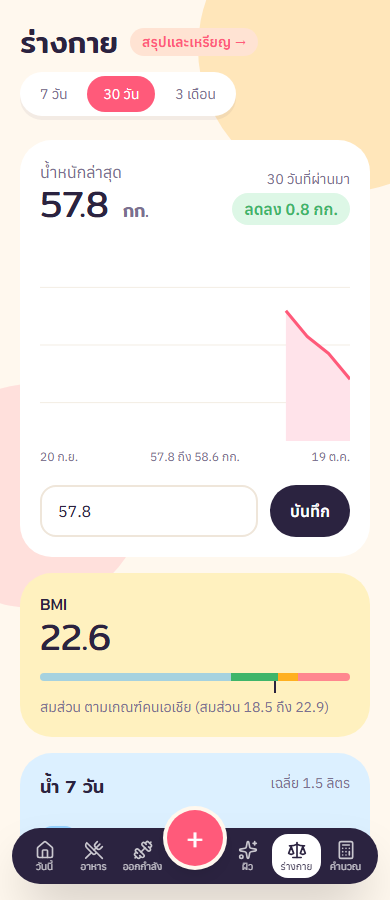
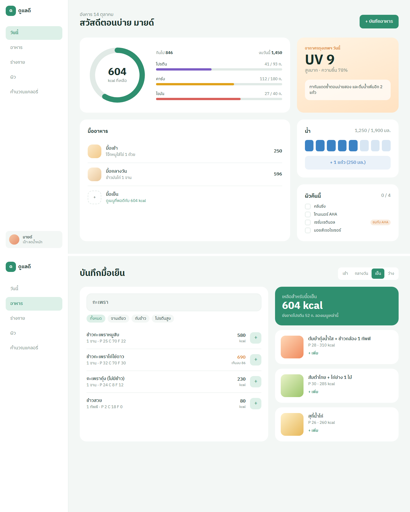
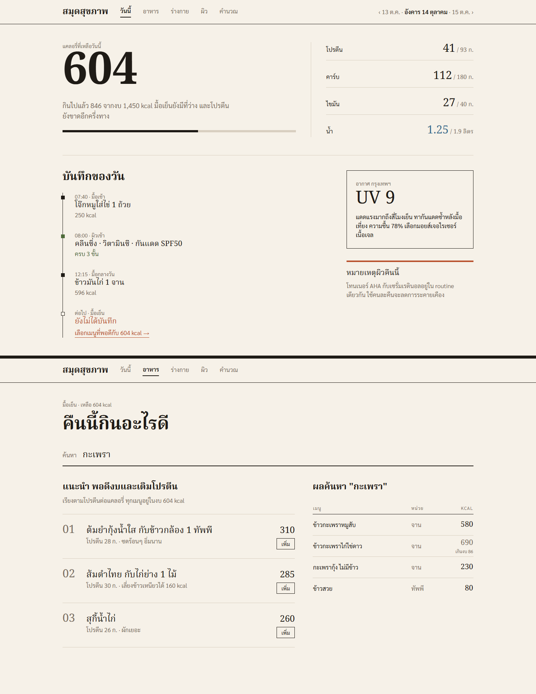
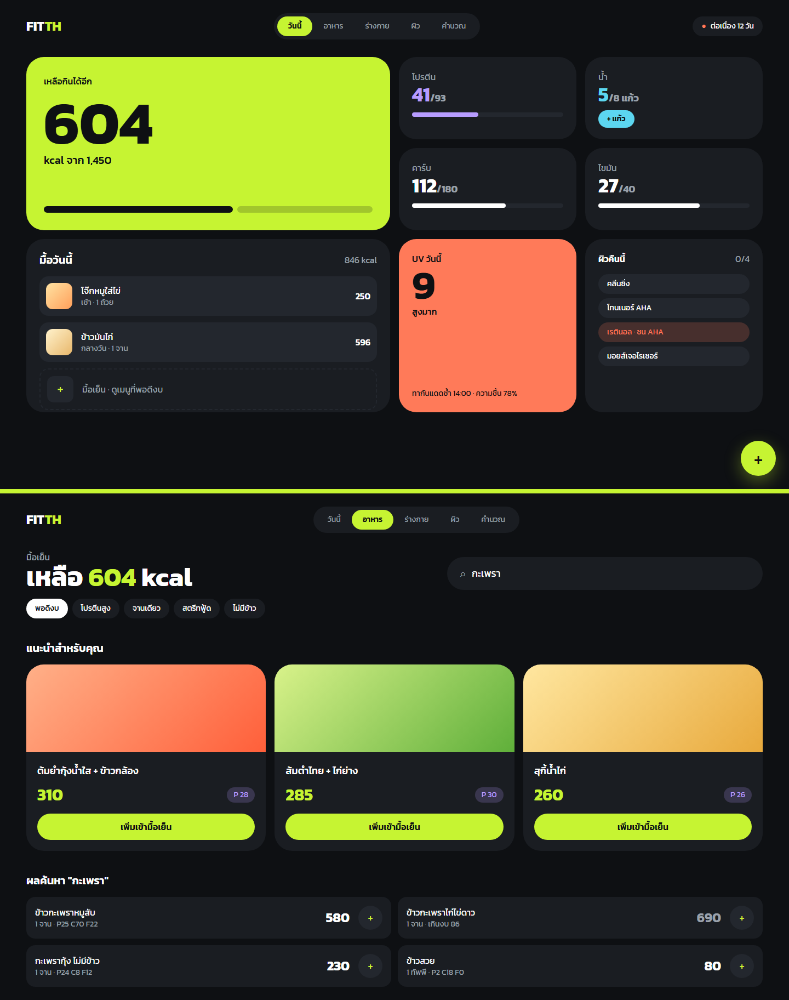
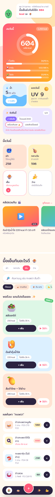
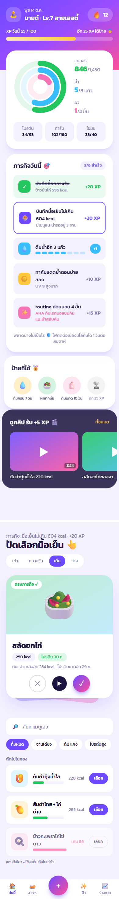
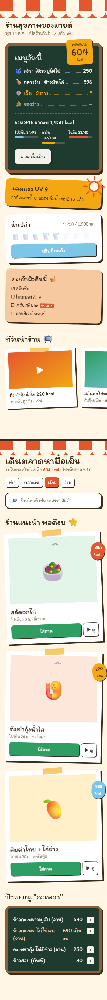

# ดูแลดี · dulaedee-client-web

หน้าเว็บของแอป "ดูแลดี" แอปดูแลสุขภาพสำหรับเพื่อนและครอบครัว ใช้นับแคลอรี่เมนูไทย จดน้ำและน้ำหนัก ทำ routine ผิว และออกกำลังกาย มีวันต่อเนื่อง เหรียญ และชาเลนจ์กลุ่มให้อยากกลับมาใช้ทุกวัน

Vue 3 · Vite · TypeScript · Pinia · Element Plus · Tailwind v4 ทำงานคู่กับ API [`dulaedee-service`](https://github.com/Teruakii/dulaedee-service)


## หน้าตาแอป

| วันนี้ | อาหาร | สรุปและเหรียญ |
|---|---|---|
|  |  |  |
| งบแคลอรี่ที่เหลือ สารอาหาร น้ำ UV ผิว ออกกำลัง และวันต่อเนื่อง | กดเพิ่มเมนูที่กินบ่อยหรือ "เหมือนเมื่อวาน" ได้ทันที แนะนำเมนูที่พอดีกับงบที่เหลือ | วันต่อเนื่อง 4 อย่าง ค่าเฉลี่ย 7 หรือ 30 วัน แนวโน้มน้ำหนัก และเหรียญ |

| ผิว | ร่างกาย | ชาเลนจ์กลุ่ม |
|---|---|---|
|  |  |  |
| routine เช้าและก่อนนอน เตือนส่วนผสมที่ใช้คู่กันไม่ได้ และ UV ของพรุ่งนี้ | กราฟน้ำหนัก BMI ตามเกณฑ์คนเอเชีย และน้ำ 7 วัน | ชวนเพื่อนด้วยลิงก์ แข่งกันรายสัปดาห์ เห็นกันแค่ชื่อเล่นกับจำนวนวัน |

ภาพทั้งหมดถ่ายจากแอปจริงด้วยข้อมูลตัวอย่าง 7 วัน

## ที่มาของดีไซน์

**รอบแรก:** ลองไว้ 3 แนว (สงบ, แบบนิตยสาร, ตัวหนา) ผู้ใช้เลือกแนว A แล้วขยายเป็น 9 หน้า แต่ลองใช้แล้วรู้สึกว่ายังไม่สดใสพอ

| A สงบ | B นิตยสาร | C ตัวหนา |
|---|---|---|
|  |  |  |

**รอบสอง:** ทำใหม่อีก 3 แนว แล้วเลือก **D ป๊อป** สีสด การ์ดโค้งมน และมีมาสคอตใบไม้ แอปจริงใช้แนวนี้

| D ป๊อป ✅ | E เควสต์ | F ตลาด |
|---|---|---|
|  |  |  |

ข้อความและตัวเลขใน mockup แต่งขึ้นเพื่อวาดเท่านั้น

## เริ่มใช้งาน

```bash
npm install
cp .env.example .env     # baseURL ชี้ API ที่ port 3200
npm run dev              # http://localhost:5190
```

ลองแบบไม่ต้องมี MongoDB: ใน `dulaedee-service` สั่ง `npm run dev:demo` แล้วเข้าด้วย `mind@example.com` / `password1`
(admin: `admin` / `admin-demo-pass`)

## ตรวจ

```bash
npm run type-check
npm run build-only
```

## โครง

- `src/api/health/*.api.ts` หนึ่งฟังก์ชันต่อ endpoint คืน `data`
- `src/stores/day.pinia.ts` บันทึกของวันที่เลือก ใช้ร่วมกันทุกหน้า · `profile.pinia.ts` ข้อมูลร่างกายและงบ
- `src/utils/labels.ts` ป้ายไทยของทุก enum จาก backend
- `src/assets/css/main.css` โทเคนสีและฟอนต์ (view ใช้ชื่อโทเคน ไม่ใส่ hex)
- `src/views/legal/` ข้อกำหนดการใช้งานและนโยบายความเป็นส่วนตัว (ฉบับร่าง เติมชื่อผู้ดูแลและอีเมลติดต่อใน `legal.ts` ก่อนเปิดใช้จริง)
- หน้า `/admin/foods` และ `/admin/clips` สำหรับ ADMIN/STAFF ดูแลฐานเมนูและคัดคลิป
